# 仕組み

図のオレンジが、本パッケージの部分です。

1. `CompilationContext.LoadSyntaxTreesAndCreateModules` にPostfixを当て、UdonSharp に渡す SyntaxTree を書き換えます。
   1. ジェネリクス：使われる型引数ごとに、ジェネリッククラス・メソッドのコピーを作り、使う側をコピーの名前にします。後の段はジェネリクスのないコードとして扱います。
   2. デリゲート（自分で宣言したもの）：デリゲート型を `object[]`（呼ぶ相手の UdonSharpBehaviour・中継メソッドの名前・予備）に置き換えます。`d = F;` は、作る側の UdonSharpBehaviour に `F` を呼ぶだけの引数なしの public メソッド（中継メソッド）を足して、その名前を入れる形にします。`d(x)` は、デリゲートの宣言の隣に置く static クラスのメソッドの呼び出しにし、その中で引数を `SetProgramVariable`、中継メソッドを `SendCustomEvent`、戻り値を `GetProgramVariable` します（引数・戻り値の変数の名前は、デリゲート型ごとに決まった名前にします）。呼び出しのメソッドには `[RecursiveMethod]` を付け、`SendCustomEvent` の前後で途中の値を UdonSharp にスタックへ積んで戻してもらいます（呼ばれた先から同じデリゲート型をまた呼んでも壊れないように）。生成するコードは普通のクラス・インタフェースの型のまま書き、後の段に書き換えてもらいます。
   3. インタフェース：インタフェース型を `object` に置き換えます。呼び出しは、普通のクラスならそのクラスのメソッドの呼び出し（実装クラスが 4 個以上なら型番号の `switch`）に、UdonSharpBehaviour なら `SetProgramVariable`／`SendCustomEvent`／`GetProgramVariable` 経由に振り分けます。`is`／`as` は型タグと型IDで判定する形にします。
   4. 普通のクラス：インスタンスを `object[]` にし、コンストラクタ・メソッドのコピーを、使う UdonSharpBehaviour に生成します。
   5. List / Dictionary：`DataList` / `DataDictionary` に置き換え、要素の出し入れを `DataToken` との変換にします。`foreach` は添字で回すループにします。ラムダを受け取るメソッドは、ループとラムダの本体を入れたメソッドを生成し、その呼び出しにします。外のローカル変数・引数は、読むだけなら値で、書き込むなら `ref` で渡します（書き込むかどうかは Roslyn のデータフロー解析で判定します）。LINQ は、つないだ呼び出しを 1 つのループの生成メソッドにまとめます。
   6. 生成したメソッドは、使う UdonSharpBehaviour ごとに同じ名前で作ります。基底と派生の両方に同じ名前のものができると、UdonSharp が「基底のメソッドを隠している」とみなしてエラーにするので、最後に派生の側の名前を変えます（`__if_GetWidth__call__Game_Derived` など、クラスの完全名を付けます）。partial のクラスの 2 つのファイルの両方に同じ名前のものができたときも、2 つ目のファイルの側の名前を変えます（`__p2` を付けます）。
2. `CompilationContext.MethodExportLayout` のコンストラクタにPrefixを当て、インタフェース実装メソッドの Udon 上の名前を、どの実装クラスでも揃うものにします（メソッドは元の名前、引数は `Damage__int__string__p0`、戻り値は `Damage__int__string__ret`）。
3. `CompilationContext.AddDiagnostic` と `AssemblyDebugInfo`（実行時例外の位置を引くデバッグ情報）にパッチを当て、普通のクラスのコピーの中の位置を、元のクラスのソースの位置に戻します。
4. `Serializer.Create`（エディタ上の C# のコンポーネントと Udon の変数の間で値を写す方法を決める処理）にPrefixを当て、型を書き換えたフィールド（List・Dictionary・普通のクラス・インタフェース・デリゲートと、それらの配列）は写さないようにします。C# 側と Udon 側で型が違うため、そのままだと Play モードに入るたびに `not compatible with serializer` のエラーが出ます。
5. `UdonSharpUpgrader.UpgradeScripts`（UdonSharp の自動アップグレード。プログラムアセットを新しく作ったときなどに、フィールドに `[OdinSerialize]` を足してスクリプトのファイルに書き戻す処理）にパッチを当て、その中でのソースの読み込みでは 1 の書き換えをしないようにします。書き換えると、書き換え後のコードがユーザーのスクリプトに書き込まれてしまうためです。アップグレードの最後に走る UdonSharp のコンパイルでは、普通に書き換えます。
   また、アップグレードが `[OdinSerialize]` を足すフィールドから、本パッケージが書き換える型（普通のクラス・インタフェース・デリゲートと、その配列）のフィールドを外します（`SerializationUpdateSyntaxRewriter.VisitFieldDeclaration` にPrefix）。書き換えた後はシリアライズしない型で、`[OdinSerialize]` があると UdonSharp がシリアライズするフィールドとみなし、`null` でなく空の配列で始めてしまうためです。すでに付いているものは、1 の書き換えで外します。
   書き換えないので、アップグレードには UdonSharp の知らない書き方（ジェネリッククラスの `T` 型のフィールドなど）が見えます。アップグレードの間は `TypeSymbol.TryGetSystemType` にもパッチを当て、そうした型は「型が分からない」として飛ばすようにしています（そのままだと例外になり、アップグレードが毎フレームやり直されてエディタが使えなくなるため）。それでもアップグレードが例外で止まったときは、毎フレームやり直さないよう、アップグレードの印を消します。

書き換え後のソースは、デバッグ用に `Library/UdonSharpPlus/` に、元のスクリプトと同じフォルダの形で出力されます（コンパイルのたびに作り直します）。
