# UdonSharp Plus

[English](README.md) | 日本語

UdonSharp で書ける C# を増やす、VRChat ワールド制作向けのエディタ拡張です。UdonSharp の非公式の拡張で、UdonSharp・VRChat の公式のものではありません。

UdonSharp のコンパイラに Harmony でパッチを当て、UdonSharp がコンパイルする前に、ソースを UdonSharp が扱える形に書き換えます。出力されるのは通常の Udon プログラムなので、VRChat のクライアント側には何も要りません。

> **実験段階です。** UdonSharp の内部 API に依存しているため、VRChat SDK のバージョンが変わると動かなくなる可能性があります。対応していない SDK では自動で無効になり、素の UdonSharp と同じ動きになります。

## できること

| 機能 | 例 |
|---|---|
| インタフェース | `class Enemy : UdonSharpBehaviour, IDamageable`、`((IDamageable)target).Damage(10)`、`is`／`as`、`[NetworkCallable]` の実装 |
| 普通のクラス<br>（UdonSharpBehaviour 以外） | `new Bullet(pos)`、`b.Move(d)`、プロパティ、static メソッド、クラスの配列 |
| ジェネリクス | `class Pool<T>`、`static T Max<T>(List<T> list) where T : IComparable<T>` |
| List / Dictionary | `List<int>`、`Dictionary<string, Bullet>`、`foreach`、`TryGetValue` |
| ラムダ・LINQ | `list.Find(b => b.damage > 0)`、`list.Where(...).Select(...).ToList()`、`OrderBy`、`Sum` |

```csharp
using System.Collections.Generic;
using System.Linq;
using UdonSharp;
using UnityEngine;

public interface IDamageable
{
    void Damage(int amount);
}

public class Slime : IDamageable
{
    public int hp = 30;
    public void Damage(int amount) { hp -= amount; Debug.Log($"Slime HP: {hp}"); }
}

public class Golem : IDamageable
{
    public int hp = 100;
    public void Damage(int amount) { hp -= amount / 2; Debug.Log($"Golem HP: {hp}"); }
}

public class Bullet
{
    public int damage;
    public Bullet(int damage) { this.damage = damage; }
}

public class Attacker : UdonSharpBehaviour
{
    private List<Bullet> _bullets = new List<Bullet>();
    private List<IDamageable> _enemies = new List<IDamageable>();

    private void Start()
    {
        _bullets.Add(new Bullet(5));
        _bullets.Add(new Bullet(20));
        int total = _bullets.Where(b => b.damage > 10).Sum(b => b.damage);

        _enemies.Add(new Slime());
        _enemies.Add(new Golem());
        foreach (IDamageable e in _enemies)
            e.Damage(total);
    }
}
```

どの機能も、対応していない書き方はコンパイルエラーになります。何がどこまで書けるかは、[ドキュメント](Packages/com.pandanakami.udonsharpplus/Documentation~/README.md)を見てください。

## 仕組み



UdonSharp（U#）のコンパイラは、C# のソースを構文解析して、Udon Assembly を生成します。UdonSharp Plus は Harmony を使って、その途中に「書き換え」の段（図のオレンジ）を差し込みます。そこで、インタフェース・普通のクラス・List などを、U# が扱える書き方（`object`、`object[]`、`DataList` など）に書き換えます。

書き換えはエディタの中だけで行われます。VRChat クライアントの Udon VM が動かすのは、通常の Udon プログラムです。詳しくは[仕組み](Packages/com.pandanakami.udonsharpplus/Documentation~/how-it-works.md)を見てください。

## 必要なもの

- Unity 2022.3
- VRChat Worlds SDK 3.10.x（UdonSharp を含む）

## 導入方法

1. [リスティングのページ](https://pandanakami.github.io/UdonSharpPlus/)で **Add to VCC** を押します。VCC（VRChat Creator Companion）が開き、リポジトリを追加する画面になります。

   または、VCC の **Settings** → **Packages** → **Add Repository** で、次の URL を追加します。

   ```
   https://pandanakami.github.io/UdonSharpPlus/index.json
   ```

2. ワールドのプロジェクトの **Manage Project** で、**UdonSharp Plus** を追加します。

これだけで有効になります。設定は要りません。

## 知っておいてほしいこと

- どの機能も実験的です。思ったとおりに動かないときは、書き換え後のソース（プロジェクトの `Library/UdonSharpPlus/`）を見ると、何に書き換わったか分かります。
- 対応していない VRChat SDK では、コンソールに `[UdonSharpPlus] この VRChat SDK（…）では UdonSharp の内部が変わっているため、無効にしました` のエラーが出ます。そのときは UdonSharp Plus を更新してください。
- 詳しいドキュメントと、本パッケージが出すエラー・警告の文言は日本語です。

## 対応予定

次のものに対応する予定です（まだ使えません）。時期は決まっておらず、内容も変わることがあります。

- デリゲート（`Action`・`Func`・`Predicate` など）
- 匿名メソッド（`delegate { ... }`）
- ローカル関数（メソッドの中に書いたメソッド）
- 匿名型（`new { Name = "a", Hp = 10 }`）と、そのリスト
- タプル
- 演算子のオーバーロード
- コルーチン

## 免責事項

UdonSharp Plus を使うことによって生じたいかなる損害についても、作者は一切の責任を負いません。自己責任でお使いください。

- UdonSharp Plus は実験段階のソフトウェアで、現状のまま、何の保証もなく提供します（MIT License）。損害には、プロジェクトやワールドが壊れる、データが失われる、正しく動かないワールドを公開してしまう、などを含みます。
- UdonSharp Plus は個人が作った非公式の拡張です。VRChat Inc.、UdonSharp の作者・開発チームとは関係がなく、承認も受けていません。VRChat・UdonSharp・Unity・Harmony などの名前と商標は、それぞれの権利者のものです。
- UdonSharp Plus は、Unity エディタの中で UdonSharp のコンパイラの内部処理を書き換えます。VRChat SDK の更新や、UdonSharp に手を入れるほかのエディタ拡張との組み合わせで、動かなくなる・正しくないプログラムができるおそれがあります。導入前にプロジェクトをバックアップし、ワールドを公開する前には必ず動作を確かめてください。
- VRChat のクライアントには何も手を加えません。出力されるのは通常の Udon プログラムです。
- UdonSharp Plus を使っていて起きた問題は、VRChat や UdonSharp ではなく、このリポジトリの Issues に報告してください。

## ライセンス

[MIT License](LICENSE)（Copyright (c) 2026 pandanakami）

このパッケージには、VRChat SDK・UdonSharp・Harmony・Roslyn は含まれていません。これらは VRChat SDK に同梱されたものを参照しているだけで、それぞれのライセンスに従います（VRChat SDK：https://hello.vrchat.com/legal/sdk ）。
