# Custom UdonSharp

English | [日本語](README.ja.md)

An editor extension for VRChat world creators that lets you write more of C# in UdonSharp.

It patches the UdonSharp compiler with Harmony and rewrites your source into a form UdonSharp can handle, right before UdonSharp compiles it. The output is a regular Udon program, so nothing extra is needed on the VRChat client.

> **Experimental.** This package depends on UdonSharp internals, so it may stop working when the VRChat SDK changes. On an unsupported SDK it disables itself, and UdonSharp behaves as usual.

## Features

| Feature | Examples |
|---|---|
| Interfaces | `class Enemy : UdonSharpBehaviour, IDamageable`, `((IDamageable)target).Damage(10)`, `is` / `as`, implementing `[NetworkCallable]` methods |
| Plain classes | `new Bullet(pos)`, `b.Move(d)`, properties, static methods, arrays of classes |
| Generics | `class Pool<T>`, `static T Max<T>(List<T> list) where T : IComparable<T>` |
| List / Dictionary | `List<int>`, `Dictionary<string, Bullet>`, `foreach`, `TryGetValue` |
| Lambdas and LINQ | `list.Find(b => b.damage > 0)`, `list.Where(...).Select(...).ToList()`, `OrderBy`, `Sum` |

```csharp
using System.Collections.Generic;
using System.Linq;
using UdonSharp;

public interface IDamageable
{
    int Damage(int amount);
}

public class Bullet
{
    public int damage = 10;
    public Bullet(int damage) { this.damage = damage; }
}

public class Attacker : UdonSharpBehaviour
{
    public UdonSharpBehaviour[] targets;
    private List<Bullet> _bullets = new List<Bullet>();

    private void Start()
    {
        _bullets.Add(new Bullet(5));
        _bullets.Add(new Bullet(20));
        int total = _bullets.Where(b => b.damage > 10).Sum(b => b.damage);

        foreach (UdonSharpBehaviour t in targets)
            if (t is IDamageable)
                ((IDamageable)t).Damage(total);
    }
}
```

Anything a feature does not support is reported as a compile error. For exactly what you can write, see the [documentation](Packages/com.pandanakami.customudonsharp/Documentation~/README.md) (in Japanese).

## How it works



The UdonSharp (U#) compiler parses your C# source and generates Udon Assembly. CustomUdonSharp uses Harmony to insert a "rewrite" step (orange in the diagram) in between. That step rewrites interfaces, plain classes, List and so on into code U# can handle (`object`, `object[]`, `DataList`, and so on).

The rewrite happens only in the editor. What the Udon VM runs on the VRChat client is a regular Udon program. For details, see [How it works](Packages/com.pandanakami.customudonsharp/Documentation~/how-it-works.md) (in Japanese).

## Requirements

- Unity 2022.3
- VRChat Worlds SDK 3.10.x (includes UdonSharp)

## Installation

1. In VCC (VRChat Creator Companion), open **Settings** → **Packages** → **Add Repository** and add this URL:

   ```
   https://pandanakami.github.io/CustomUdonSharp/index.json
   ```

2. In your world project, open **Manage Project** and add **Custom UdonSharp**.

That's all. There is nothing to configure.

## Good to know

- All features are experimental. If something does not work as expected, the rewritten source in your project's `Library/CustomUdonSharp/` shows what your code was turned into.
- On an unsupported VRChat SDK, the console shows an error starting with `[CustomUdonSharp]` saying the package was disabled because UdonSharp internals changed. Update Custom UdonSharp when you see it.
- The detailed documentation and the package's own error and warning messages are in Japanese for now.

## License

[MIT License](LICENSE) (Copyright (c) 2026 pandanakami)

This package does not include the VRChat SDK, UdonSharp, Harmony, or Roslyn. It only references the copies that ship with the VRChat SDK; each is covered by its own license (VRChat SDK: https://hello.vrchat.com/legal/sdk).
